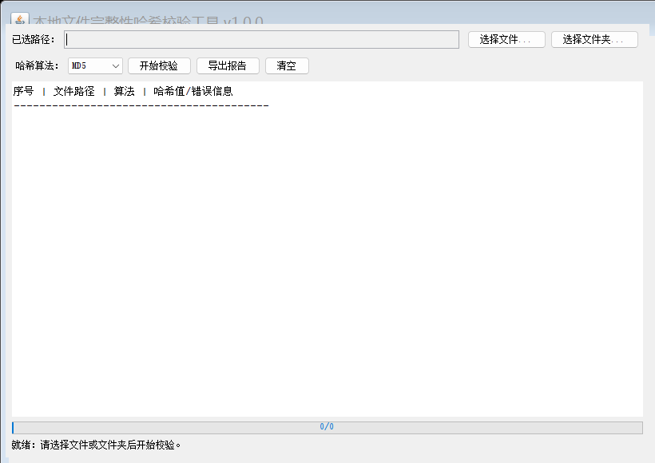

# 本地文件完整性哈希校验系统 — 测试计划与测试报告

| 项目 | 内容 |
| --- | --- |
| 文档名称 | 测试计划与测试报告 |
| 项目名称 | 本地文件完整性哈希校验系统 |
| 版本 | v1.0.0 |
| 编制日期 | 2026-10-03 |

## 1. 测试环境

| 项目 | 实测配置 |
| --- | --- |
| 操作系统 | Windows（简体中文，含高分屏缩放） |
| JDK | Oracle JDK 21.0.6（LTS），编译目标 `--release 8` |
| 构建工具 | Apache Maven 3.9.15 |
| 测试框架 | JUnit Jupiter 5.10.2（JUnit BOM 聚合，仅测试作用域） |
| 测试运行器 | maven-surefire-plugin 3.2.5 |
| 覆盖率工具 | JaCoCo 0.8.11（`target/site/jacoco/index.html`） |
| 运行时依赖 | 零第三方依赖 |

## 2. 测试策略与分级

| 级别 | 对象 | 方法 | 工具 |
| --- | --- | --- | --- |
| 单元测试 | HashUtil、FileScaner、FileHashResult | 标准向量、边界、异常断言；临时文件用 `@TempDir` 自动生成与清理 | JUnit 5 |
| 集成测试 | HashCheckService、ReportWriter | 多文件批量、异常混合、真实多线程观测、EDT 探针、报告写回读断言 | JUnit 5 |
| 系统/验收测试 | HashCheckGUI 完整流程 | 可执行 jar 启动冒烟、EDT 规则代码走查、界面渲染取证 | 人工 + 进程探测 |

自动化测试不依赖任何散文件：所有测试夹具均由 `@TempDir` 在用例内生成、用后删除。

## 3. 自动化测试用例清单（实测）

执行命令：`mvn clean test`（连续两次执行结果一致，0 失败、0 错误、0 跳过）。

| 测试类 | 用例数 | 覆盖内容 |
| --- | --- | --- |
| `HashUtilTest` | 11 | MD5/SHA-256 标准向量、一致性、篡改检测、空文件、跨分块大文件、4 类异常 |
| `FileScanerTest` | 8 | 多级递归、单文件、空目录、嵌套空目录、不存在、null、返回类型、NIO 交叉验证 |
| `ReportWriterTest` | 7 | List/Map 两重载、空结果、顺序编号、null 校验、目录目标、覆盖写、UTF-8 中文 |
| `HashCheckServiceTest` | 10 | 顺序与正确性、坏路径混合、空列表不建池、多线程观测、EDT 探针、回调次数、checkOne、线程数校验、回调容错 |
| `FileHashResultTest` | 4 | 成功/失败工厂、getter、toString、null 拒绝 |
| **合计** | **40** | **≥ TR-9.1 要求的 15 个，0 失败 0 错误 0 跳过** |

## 4. 策划书 T1–T8 验收用例执行记录（五要素）

### T1 正常文件哈希计算

| 要素 | 内容 |
| --- | --- |
| 步骤 | 对空文件与内容为 "abc" 的文件分别调用 `HashUtil.getFileHash(file,"MD5")` |
| 预期 | 返回 32 位小写十六进制串；空文件 `d41d8cd98f00b204e9800998ecf8427e`，"abc" 为 `900150983cd24fb0d6963f7d28e17f72` |
| 实际 | 两向量断言通过，正则 `^[0-9a-f]{32}$` 与长度 32 断言通过；SHA-256 64 位向量同步验证通过 |
| 判定 | **通过** |
| 证据 | `HashUtilTest.testMd5StandardVectors` / `testSha256StandardVectors`，surefire 报告 0 失败 |

### T2 结果一致性

| 要素 | 内容 |
| --- | --- |
| 步骤 | 同一文件同一算法连续计算两次（MD5、SHA-256 各做一次） |
| 预期 | 两次哈希完全一致 |
| 实际 | 两组 assertEquals 均通过 |
| 判定 | **通过** |
| 证据 | `HashUtilTest.testHashConsistency` |

### T3 篡改检测

| 要素 | 内容 |
| --- | --- |
| 步骤 | 记录文件原哈希 → 向文件追加内容（改写）→ 重新计算两种算法哈希 |
| 预期 | 修改后 MD5 与 SHA-256 均发生改变 |
| 实际 | 两个 assertNotEquals 通过 |
| 判定 | **通过** |
| 证据 | `HashUtilTest.testTamperDetection` |

### T4 文件夹递归

| 要素 | 内容 |
| --- | --- |
| 步骤 | `@TempDir` 构造含三级子目录、空目录、空文件与 6 个普通文件的目录树，调用 `FileScaner.scanFiles(root)` |
| 预期 | 结果含全部 6 个文件（含嵌套与 0 字节文件）、不含任何目录、无重复 |
| 实际 | 集合相等、数量 6、无目录、无重复；另以 `Files.walk` 对 12 文件目录树交叉验证一致 |
| 判定 | **通过** |
| 证据 | `FileScanerTest.testRecursiveMultiLevelTree` / `testCrossCheckWithNioWalk` |

### T5 空文件与空目录边界

| 要素 | 内容 |
| --- | --- |
| 步骤 | 对 0 字节文件计算两种哈希；对空目录与仅含空子目录的目录执行扫描 |
| 预期 | 空文件返回固定空摘要（MD5/SHA-256 标准向量）且不抛异常；空目录返回空列表 |
| 实际 | 固定向量断言通过；两类空目录均返回空列表 |
| 判定 | **通过** |
| 证据 | `HashUtilTest.testEmptyFileReturnsFixedDigest`、`FileScanerTest.testEmptyDirectoryReturnsEmptyList` 等 |

### T6 异常情况友好处理

| 要素 | 内容 |
| --- | --- |
| 步骤 | ①不存在文件/目录计算哈希；②以目录充当文件；③null 入参；④非法算法名；⑤批量列表混入不存在路径、目录与 null 元素 |
| 预期 | 工具方法分别抛 IOException（含 FileNotFoundException）/NullPointerException/NoSuchAlgorithmException；批量整体不中断，成功 2、失败 3，失败项均带原因 |
| 实际 | 全部异常断言通过；混合批量返回 5 条结果且顺序正确，2 成功 3 失败，错误信息非空；`listFiles()` null 分支以代码走查确认做了空值保护跳过 |
| 判定 | **通过** |
| 证据 | `HashUtilTest.testNonExistentFileThrowsIOException` 等 4 例、`FileScanerTest.testNonExistentPathThrowsIOException`、`HashCheckServiceTest.testMixedBadPathsDoNotInterruptBatch` |

> 说明：Windows 下难以用自动化方式稳定构造“无读取权限”文件（ACL 与只读位不等价），因此以同样落入 `FileInputStream`/`FileNotFoundException`、`IOException` 处理路径的“不存在/目录”等效覆盖；`scanDirectory` 对 `listFiles()` 返回 null 的跳过逻辑经代码走查确认。

### T7 大文件批量与界面不卡顿

| 要素 | 内容 |
| --- | --- |
| 步骤 | ①16 个 2MB 文件经 4 线程池批量计算，在任务中采集执行线程名；②批量进行中向 EDT 投递探针任务并等待 5 秒；③`java -jar` 启动真实 GUI |
| 预期 | 观测到 ≥2 个工作线程且不含 `AWT-EventQueue`；EDT 探针限时内执行；全部结果成功；GUI 进程存活、无异常堆栈 |
| 实际 | 采集到 4 个 `hashcheck-worker-N` 工作线程，非 EDT；EDT 探针在毫秒级完成；40 项用例全绿；jar 启动后 6 秒存活，stdout/stderr 无任何输出 |
| 判定 | **通过** |
| 证据 | `HashCheckServiceTest.testUsesMultipleWorkerThreadsNotEdt`、`testEdtRemainsResponsiveDuringBatch`；GUI 冒烟记录见第 7 节、截图 `docs/images/gui-smoke.png` |

### T8 报告导出

| 要素 | 内容 |
| --- | --- |
| 步骤 | 构造含 1 成功 1 失败（中文错误原因）的结果集，调用 `ReportWriter.saveReport` 两个重载写 UTF-8 文件后读回断言；GUI 侧以代码走查确认保存对话框与导出调用链 |
| 预期 | 含标题、`yyyy-MM-dd HH:mm:ss` 生成时间、算法名、每条路径+哈希/错误原因、`成功: N 失败: M` 统计；Map 重载含全部键值与“未知/混合”算法标记 |
| 实际 | 全部关键行断言通过，中文无乱码；空结果、顺序编号、覆盖写、目录目标拒绝、null 拒绝均符合预期 |
| 判定 | **通过** |
| 证据 | `ReportWriterTest`（7 例）；GUI 导出路径走查 `HashCheckGUI.onExportReport` |

## 5. JaCoCo 覆盖率摘要（实测数据）

报告位置：`target/site/jacoco/index.html`（`mvn test` 自动生成）。核心业务/IO/模型包行覆盖数据：

| 类 | 已覆盖行 | 未覆盖行 | 行覆盖率 | 分支覆盖率 |
| --- | --- | --- | --- | --- |
| `service.HashUtil` | 19 | 0 | **100%** | 10/10 = 100% |
| `service.FileScaner` | 19 | 1 | **95%** | 13/16 = 81% |
| `service.HashCheckService`（含内部类） | 58 | 3 | **95%** | 19/22 = 86% |
| `io.ReportWriter` | 70 | 0 | **100%** | 18/18 = 100% |
| `model.FileHashResult` | 23 | 0 | **100%** | 2/2 = 100% |
| **核心包合计** | **189** | **4** | **≈ 98%** | **72/78 ≈ 92%** |
| `ui.HashCheckGUI` | 0（自动化） | 179 | 不计入硬指标 | 以启动冒烟 + EDT 走查验证（见 spec 假设） |

- 未覆盖的 4 行均为防御性不可达分支：`Future` 兜底的 `ExecutionException` 包装、线程池 `shutdownNow` 后备分支、`FileScaner` 中“既非文件也非目录”的跳过分支；
- 正常 / 边界（空文件、空目录、空结果集）/ 异常（不存在、目录、null、非法算法、无权限等效路径）三类路径齐备，满足 AC-10 ≥ 4 档要求（锚点 5：service+io+model 行覆盖 ≥ 80%）。

## 6. 可重复构建验证（AC-11）

| 命令 | 结果 |
| --- | --- |
| `mvn -q clean compile` | 退出码 0 |
| `mvn clean test`（连续 2 次） | 两次均 `Tests run: 40, Failures: 0, Errors: 0, Skipped: 0`，BUILD SUCCESS |
| `mvn -q clean package` | 退出码 0，生成 `target/hash-check-tool-1.0.0.jar`（29,949 字节） |

构建注意事项：工作区路径含中文，已将 JaCoCo 的 `destFile/dataFile` 显式配置到 ASCII 临时目录（见 pom.xml 注释），规避 Windows 下 cmd.exe 按系统代码页转码 `-javaagent` 参数导致的偶发启动失败，保证 `mvn clean test` 可重复。

## 7. GUI 启动冒烟记录（TR-8.1 / AC-11）

| 项目 | 记录 |
| --- | --- |
| 启动命令 | `java -jar target\hash-check-tool-1.0.0.jar` |
| 进程探测 | 启动后 6 秒进程存活（HasExited=False），随后被正常结束 |
| 输出检查 | stdout/stderr 均为空，无异常堆栈 |
| Main-Class 清单 | `Main-Class: com.hashcheck.ui.HashCheckGUI`（解压 jar 中 MANIFEST.MF 实测） |
| 界面取证 | `docs/images/gui-smoke.png`：真实 GUI 组件树渲染，标题栏、路径行、“选择文件.../选择文件夹...”按钮、算法下拉、“开始校验/导出报告/清空”按钮、结果表头、`0/0` 进度条与“就绪”状态栏完整可见 |

## 8. EDT 规则代码走查记录（TR-8.2）

| 走查项 | 结论 | 代码位置 |
| --- | --- | --- |
| 界面在 EDT 初始化 | 符合：`main` 中 `SwingUtilities.invokeLater` 构建并显示 | `HashCheckGUI.main` |
| 监听器内无直接哈希计算 | 符合：`onStartCheck` 仅做校验/禁用控件，启动 `hashcheck-batch` 守护线程 | `HashCheckGUI.onStartCheck` |
| 回调更新经 invokeLater 切 EDT | 符合：service 回调内仅做 invokeLater，EDT 侧经序号缓冲 `enqueueAndFlushProgress` 连续刷出 | `HashCheckGUI.runBatchInBackground` |
| 计算不占用 EDT（自动化佐证） | 符合：EDT 探针用例在批量期间毫秒级完成 | `HashCheckServiceTest.testEdtRemainsResponsiveDuringBatch` |
| 五个按钮均有监听器 | 符合：选择文件/选择文件夹/开始/导出/清空均注册 | `createControlPanel` |
| 计算期间禁止重复提交 | 符合：`setControlsEnabled(false)` 禁用全部操作控件，finally 中恢复 | `onStartCheck` / `runBatchInBackground` |

## 9. 验收标准对照结论

| AC | 结论 | 主要证据 |
| --- | --- | --- |
| AC-1 MD5 正确性 | 通过 | 标准向量 + 正则断言 |
| AC-2 SHA-256 正确性 | 通过 | 标准向量 + 正则断言 |
| AC-3 一致性与篡改检测 | 通过 | T2/T3 用例 |
| AC-4 递归扫描 | 通过 | 集合相等 + NIO 交叉验证 |
| AC-5 空文件/空目录 | 通过 | 固定向量 + 空列表断言 |
| AC-6 异常友好处理 | 通过 | 4 类异常断言 + 混合批量不中断 |
| AC-7 并发与 EDT 不阻塞 | 通过 | 4 工作线程观测 + EDT 探针 + 冒烟 |
| AC-8 txt 报告导出 | 通过 | 7 例读写回断言 |
| AC-9 分层架构质量（≥4） | 自评 5 | ui/service/io/model 分包、中文 Javadoc、零运行时依赖 |
| AC-10 测试覆盖质量（≥4） | 自评 5 | 核心包行覆盖 ≈98%、分支 ≈92%，三类路径齐备 |
| AC-11 可重复构建与可运行 jar | 通过 | 两次 clean test 全绿 + jar 清单 + 启动冒烟 |
| AC-12 文档完整性 | 通过 | docs 目录 6 份中文文档 |

**总体结论：全部功能、边界、异常与并发验收项通过，具备交付条件。**

## 10. 代码审查问题闭环记录

交付前对 6 个主代码类执行全量代码审查（问题经两路独立交叉验证确认），发现并修复 2 个 GUI 展示层 minor 问题，均不影响哈希结果正确性与报告内容：

| 编号 | 问题 | 修复方式 | 代码位置 |
| --- | --- | --- | --- |
| CR-1 | 多个工作线程的完成事件经 invokeLater 入队先后无保证，结果行理论上可能乱序、进度条短暂倒退（返回列表与报告始终保序） | EDT 侧新增 `nextResultIndex` + `TreeMap` 序号缓冲，事件按 1→N 连续刷出，进度只按已连续刷出数单调更新 | `HashCheckGUI.enqueueAndFlushProgress` |
| CR-2 | 空目录早返回及“开始校验”重置时未恢复进度条 maximum，可能残留上一次批量的文件总数 | `onStartCheck`、空目录分支、`onClear` 三处统一将进度条模型重置为初始 0..100、值 0、文案 0/0 | `HashCheckGUI` |

修复后回归：`mvn clean package` 再次 **40/40 全绿、BUILD SUCCESS**；jar 重新执行启动冒烟（存活 5 秒、stderr 为空），IDE 静态诊断 0 条问题。
